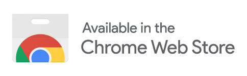
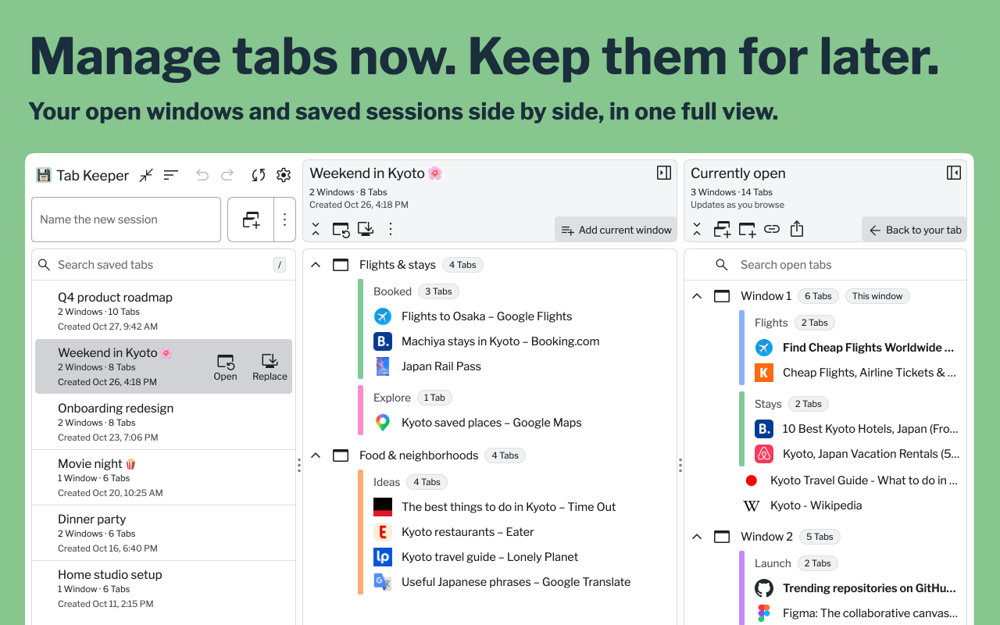

# Tab Keeper - Session & Tab Manager

<a href="https://chromewebstore.google.com/detail/tab-keeper-chrome-tab-man/gpibgniomobngodpnikhheifblbpbbah?ref=github" target="_blank"></a>

Tab Keeper is a free, open-source session and tab manager for Chrome. It manages the tabs you have open now and keeps the ones you want for later: see every window and tab group in one full view, save them as a session in one click, and bring them back with their tab group names and colors. Sync across desktop Chrome without creating an account or providing an email address.

[](https://chromewebstore.google.com/detail/tab-keeper-chrome-tab-man/gpibgniomobngodpnikhheifblbpbbah?ref=github)
[](#changelog)

[](https://raw.githubusercontent.com/justine-george/tab-keeper-react-chrome-extension/main/LICENSE)

<a href="https://chromewebstore.google.com/detail/tab-keeper-chrome-tab-man/gpibgniomobngodpnikhheifblbpbbah?ref=github" target="_blank"></a>

## Features

- **Currently Open:** See every window, tab group and tab you have open right now beside your saved sessions. Bring a window to the front, go to a tab group, or rename and recolor it.
- **Full View:** Open Tab Keeper in its own tab with panes you can widen, and go back to your tab in one click.
- **Save & Restore:** Save every open window as a session, or just the current one, and reopen it later. Sessions keep tab groups with their names and colors, pinned tabs, collapsed groups, and maximized and full-screen windows.
- **Drag Between Open and Saved:** Drop open tabs into a session to keep them, or drag saved tabs into Currently open to open them. Reorder tabs, groups, windows and sessions the same way.
- **Switch & Replace:** Jump to a saved session while Tab Keeper saves your current windows first, or replace a session with the windows you have open now.
- **Undo & Tidy Up:** Undo a delete, remove duplicate tabs, and sort tabs by site.
- **Save as PDF:** Preview any session, or the windows you have open, as a clean document, rename titles or hide rows, then save it as a PDF or print it. Or copy all its links at once.
- **Device Sync:** Turn on sync to access your sessions from Chrome desktop browsers connected to the same Chrome profile.
- **Privacy First:** No email address, account setup, or signup required. Sessions stay on your device until you choose to sync.
- **Backup to File:** Save your sessions to a file, and load them back by merging or replacing.
- **Quick Search:** Find any saved or open tab as you type, by its title or its tab group's name.
- **Keyboard Friendly:** Open Tab Keeper with a shortcut, and use it fully from the keyboard or with a screen reader.
- **Multi-Language Support:** Use Tab Keeper in 13 languages. It starts in Chrome's language.
- **Custom Themes:** Choose from seven light and dark themes, two of them with higher contrast.

## How It Works

1. Open Tab Keeper to see the windows and tabs you have open now, and save one window or all of them as a session.
2. Search, drag and organize your open tabs and saved sessions.
3. Restore a session later, or switch sessions while saving your current windows first.

## Video & Screenshots

https://github.com/user-attachments/assets/62f5a6cc-f2c2-4b4b-b722-ae473c3700fc

[Watch on YouTube →](https://www.youtube.com/watch?v=4_38WtIZxtM)

<a href="https://chromewebstore.google.com/detail/tab-keeper-chrome-tab-man/gpibgniomobngodpnikhheifblbpbbah?ref=github" target="_blank"></a>

[View All Screenshots →](https://github.com/justine-george/tab-keeper-react-chrome-extension/wiki/Screenshots)

## Privacy & Sync

Tab Keeper does not require an email address or a user-created account. It generates an anonymous identifier that Chrome syncs with your browser profile.

Your sessions are stored locally on your device. Tab Keeper asks before it syncs for the first time on each device. When device sync is enabled, saved session data—including tab URLs and titles—is sent to cloud storage so you can access it from other desktop Chrome browsers connected to the same profile. You can delete the cloud copy at any time from Settings → Sync & backup.

Read the full [privacy policy](PRIVACY.md).

## Changelog

### v.2.4.0 (Latest)

#### Features

- A Chrome split view moves as one, in Currently open and in saved sessions. Right-click either half for End split view
- Drag an open tab, split view or group onto New window in Currently open to move it into a window of its own. Pin Tab Keeper in new windows applies
- A saved tab, group or window dropped into Currently open can be undone, and redone

#### Improvements

- Open full view stays in the window you're in, instead of switching to a full view in another window. On Windows, that kept it from jumping to another virtual desktop
- Saving a new session slides the header mark's shutter
- Tooltips show sooner: 200 ms after the pointer arrives
- A new install starts on the clock its language normally uses: 24-hour in German, Spanish, French, Italian, Japanese, Portuguese, Russian, Swedish and Simplified Chinese; 12-hour in the rest. Settings › Display still switches it
- Swedish drop messages and End split view in four languages read more naturally

#### Fixes

- Another open Tab Keeper page no longer misses a change made in this one
- The strip left of a loose tab keeps its row hovered, edge to edge
- A list with little room left still offers New window at its end while you drag
- A list that fits no longer grows a scrollbar mid-drag
- A carried tab let go beside the pane, level with its own spot, no longer makes a new window
- A carried item lands in a session that already holds its ids

### v.2.3.0

#### Features

- Choose Tab Keeper's toolbar icon, in Settings › Display: Color, or Monochrome, which follows Chrome's light or dark mode
- Change a group's color from its menu: right-click its title or open its ⋮ menu, on saved groups and in Currently open
- Open saved tabs and groups in a new window, from their right-click menu
- Copy links from open windows, in the save row's ⋮ menu. It follows the Copy links setting

#### Improvements

- Saved search starts at the top of the list, so the first match is in view. Clearing it puts you back where you were
- Dialogs scroll inside a short window instead of running off it
- Tooltips and screen-reader names use each language's own punctuation
- A save field's hint that's too long for its field ends in an ellipsis
- In the popup, Settings content starts under the title, and the Sync status icon lines up with its label
- A group title's keyboard ring sits outside its text
- English text uses American spelling

#### Fixes

- A tab suspended by another extension while it waited to load comes back with its real page when you go to it
- The resize grips keep the width you chose, follow only the first touch, and stop on a lost pointer release. Ctrl+press on a Mac no longer starts a resize
- A dragged item handed back to the session list lights its row straight away
- Switching sessions from the keyboard mid-drag ends the drag, and with it the grabbing cursor
- Undoing a sort puts a Tab Keeper page back in its slot, in a window or inside a group
- Keyboard focus stays on the page's controls when the Currently open panel closes or goes away without a button press
- Renaming a session or an open group out of the search match keeps keyboard focus
- Esc closes Currently open's window menu even if its Sort item goes while the menu is open
- Row actions hide after a rename once the pointer has moved away
- An open cloud question closes when another page answers it

### v.2.2.1

#### Improvements

- Dialogs look more consistent: titles share one style, and their icons line up with the text

## Blog Posts

[View All Posts →](https://github.com/justine-george/tab-keeper-react-chrome-extension/wiki/Blog-Posts)

## Development and Contributing

Contributions are welcome! Feel free to open issues or submit pull requests following the established coding style and guidelines.

Install the dependencies and create a production build:

```sh
npm install
npm run build
```

To try the extension locally, open `chrome://extensions`, enable **Developer mode**, choose **Load unpacked**, and select the generated `dist` directory.

Run `npm test` for the unit and component suites, and `npm run test:e2e` for the browser tests against a real build ([details](e2e/README.md)).

## Built With

[React](https://react.dev/), [TypeScript](https://www.typescriptlang.org/), [Redux Toolkit](https://redux-toolkit.js.org/), [Vite](https://vitejs.dev/), [Firebase](https://firebase.google.com/), [Vitest](https://vitest.dev/), [Playwright](https://playwright.dev/), [Emotion](https://emotion.sh/), and [react-i18next](https://react.i18next.com/).

## License

Tab Keeper is released under the [MIT License](https://raw.githubusercontent.com/justine-george/tab-keeper-react-chrome-extension/main/LICENSE).

## Support

Report bugs or request features via [GitHub Issues](https://github.com/justine-george/tab-keeper-react-chrome-extension/issues).
