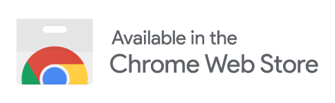
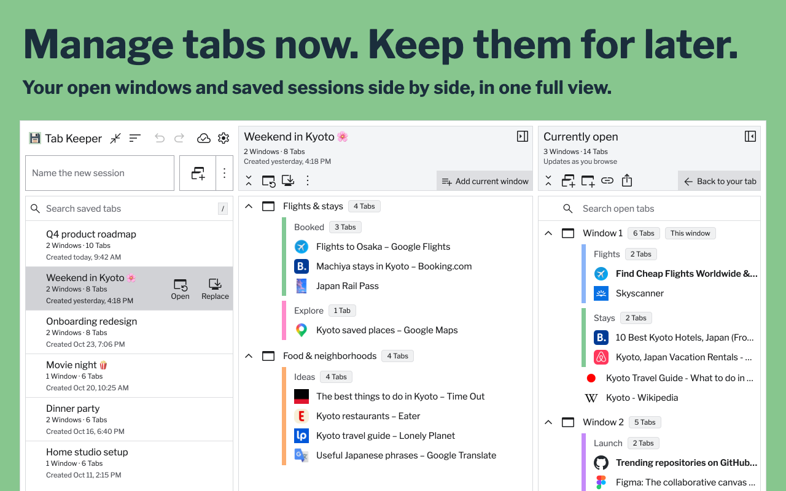

# Tab Keeper - Session & Tab Manager

<a href="https://chromewebstore.google.com/detail/tab-keeper-chrome-tab-man/gpibgniomobngodpnikhheifblbpbbah?ref=github" target="_blank"></a>

Tab Keeper is a free, open-source session and tab manager for Chrome. It manages the tabs you have open now and keeps the ones you want for later: see every window and tab group in one full view, save them as a session in one click, and bring them back with their tab group names and colors. Sync across desktop Chrome without creating an account or providing an email address.

[](https://chromewebstore.google.com/detail/tab-keeper-chrome-tab-man/gpibgniomobngodpnikhheifblbpbbah?ref=github)
[](#changelog)

[](https://raw.githubusercontent.com/justine-george/tab-keeper-react-chrome-extension/main/LICENSE)

<a href="https://chromewebstore.google.com/detail/tab-keeper-chrome-tab-man/gpibgniomobngodpnikhheifblbpbbah?ref=github" target="_blank"></a>

## Features

- **Currently Open:** See every window, tab group and tab you have open right now beside your saved sessions. Bring a window to the front, go to a tab group, or rename and recolor it.
- **Full View:** Open Tab Keeper in its own tab with panes you can widen, and go back to your tab in one click.
- **Save & Restore:** Save every open window as a session, or just the current one, and reopen it later. Sessions keep tab groups with their names and colors, pinned tabs, collapsed groups, and maximized and full-screen windows.
- **Drag Between Open and Saved:** Drop open tabs into a session to keep them, or drag saved tabs into Currently open to open them. Reorder tabs, groups, windows and sessions the same way.
- **Switch & Replace:** Jump to a saved session while Tab Keeper saves your current windows first, or replace a session with the windows you have open now.
- **Undo & Tidy Up:** Undo a delete, remove duplicate tabs, and sort tabs by site.
- **Save as PDF:** Preview any session, or the windows you have open, as a clean document, rename titles or hide rows, then save it as a PDF or print it. Or copy all its links at once.
- **Device Sync:** Turn on sync to access your sessions from Chrome desktop browsers connected to the same Chrome profile.
- **Privacy First:** No email address, account setup, or signup required. Sessions stay on your device until you choose to sync.
- **Backup to File:** Save your sessions to a file, and load them back by merging or replacing.
- **Quick Search:** Find any saved or open tab as you type, by its title or its tab group's name.
- **Keyboard Friendly:** Open Tab Keeper with a shortcut, and use it fully from the keyboard or with a screen reader.
- **Multi-Language Support:** Use Tab Keeper in 13 languages. It starts in Chrome's language.
- **Custom Themes:** Choose from seven light and dark themes, two of them with higher contrast.

## How It Works

1. Open Tab Keeper to see the windows and tabs you have open now, and save one window or all of them as a session.
2. Search, drag and organize your open tabs and saved sessions.
3. Restore a session later, or switch sessions while saving your current windows first.

## Screenshots

https://github.com/user-attachments/assets/b447682a-6835-4e4a-9868-14d05a95e489

[Watch on YouTube →](https://www.youtube.com/watch?v=OfRSR3GYYig)

<a href="https://chromewebstore.google.com/detail/tab-keeper-chrome-tab-man/gpibgniomobngodpnikhheifblbpbbah?ref=github" target="_blank"></a>

[View All Screenshots →](https://github.com/justine-george/tab-keeper-react-chrome-extension/wiki/Screenshots)

## Privacy & Sync

Tab Keeper does not require an email address or a user-created account. It generates an anonymous identifier that Chrome syncs with your browser profile.

Your sessions are stored locally on your device. Tab Keeper asks before it syncs for the first time on each device. When device sync is enabled, saved session data—including tab URLs and titles—is sent to cloud storage so you can access it from other desktop Chrome browsers connected to the same profile. You can delete the cloud copy at any time from Settings → Sync & backup.

Read the full [privacy policy](PRIVACY.md).

## Changelog

### v.2.0.1 (Latest)

#### Fixes

- After a drop, the rows that made room stay put instead of jumping, whether you drop open tabs into a saved session or a saved tab or group into Currently open
- A saved tab or group dropped into Currently open shows its saved title while its page loads, instead of a blank row or its address
- A window opened by a drop into Currently open comes to the front, opens maximized if it was saved that way, and scrolls into view in the list
- While you drag a saved window over a long Currently open list, the New window box stays in view at the bottom of the list
- With no other tabs open, Currently open still takes a saved tab, group or window dropped on it, and opens it in a new window

### v.2.0.0

#### Features

- Currently open: a pane beside your saved sessions that lists every window, tab group and tab open right now, with its own search. The window you're in comes first, and the tab you came from is marked
- From Currently open, bring a window to the front, go to a tab group, rename or recolor a group, and save one window, all of them, or a single group as a session
- Open Tab Keeper as a full view in its own tab, with panes you can widen, and go back to your tab with Back to your tab
- Drag a tab, tab group or window to another saved session, or out into a new window. A handle shows what can be dragged
- Drag between Currently open and your saved sessions: drop a saved tab, group or window into Currently open to open it, or drag open tabs into a session to copy them there
- Drag a tab in among the pinned tabs to pin it, or out to unpin it, in saved sessions and in Currently open
- Replace a saved session with the windows you have open now, keeping its name and its place in the list
- Saved sessions keep pinned tabs, the active tab, collapsed tab groups, maximized and full-screen windows, and split view, and restore them
- Remove duplicate tabs from a session, window or group, sort a window's tabs by site, and sort its tab groups by name
- Undo a deleted session, window, group or tab, and step back through moves in Currently open with Ctrl+Z. Sessions deleted on this device wait in Settings → Recently deleted for 30 days
- Copy all links from a window, a group, a saved session, or everything you have open
- Right-click any row for its menu, and rename sessions, windows, groups and tabs from it or by clicking a title
- A short setup and a guided tour on first run, and a What's new tour after upgrading. Until your first save, arrows point at the save button
- Tab Keeper starts in Chrome's language, and adds Traditional Chinese, Korean and Swedish, for 13 languages
- Two higher-contrast themes, Chalk and Charcoal. A new install starts in Chalk, and Paper and Graphite move to Chalk and Charcoal once
- Settings for 12- or 24-hour time, and for whether the save button saves all windows or only the current one
- On a new computer, the first run picks up the sessions you synced from another one, and Settings → Sync & backup shows how much of the sync limit your sessions use

#### Fixes

- Muting a tab in Currently open and Chrome's own site mute now agree, and sorting by site no longer makes Chrome's tabs jump around
- Search keeps the first match in view and also matches tab group titles. Clearing it puts the list back where it was
- A dropped row lands where the drag preview showed it, and the rows that made room no longer jump
- Reopen brings a closed window or tab back where it was, in its tab group, with its Back and Forward history
- Tab Keeper's own tab is left out of a saved session, and a window is saved as it really is
- With "Pin Tab Keeper in new windows" on, the pinned tab survives Switch and extension updates, and no longer turns up in a normal window after an incognito one
- An edit made while a sync runs is kept, two open Tab Keeper pages no longer overwrite each other, and nothing uploads before you say yes to sync
- Esc closes the menu, dialog or field you're in instead of the whole popup
- The Delete key deletes the selected session, and keyboard focus lands in a sensible place after a rename or a delete
- When this device's storage is full, Tab Keeper says so instead of losing the change on the next open
- A click outside an open menu only closes the menu, and a row's Switch button works on the first click

#### Improvements

- Currently open's rows match the saved list, with a clearer mark for the active tab beside a group's color
- The narrow Currently open drawer closes with Esc or a click outside, and its close button sits in the top corner
- Sync status reads more clearly, and size-limit warnings show before you turn sync on
- Focus rings match the app's look and show only when you move with the keyboard
- Text and controls are easier to read in every theme, screen readers hear clearer button names, and the Settings gear stays still when your system asks for reduced motion
- Messages stack instead of replacing each other, and stay longer when they need you
- Session dates say Today or Yesterday, and sorting by name puts Trip 2 before Trip 10
- Window and group rows show how many tabs they hold, and a cut-off title shows in full when you point at it
- Export is now Save as PDF, and the file shows each tab's site icon. The page says it's a preview, and closing it takes you back to the tab you started on
- Translations read more naturally, counts follow each language's word order, and Japanese and Chinese text uses the right character forms
- The first run and the tour fit more languages and window sizes, and point at the right place even with vertical tabs. The sample session stays if you moved your own tabs into it
- Settings is easier to scan and lists Chrome's language first. Change shortcut opens Chrome's shortcuts page and shows the new key when you come back
- Leaving the full view returns you to the tab you opened it from, and offers to pin it first so it stays open

### v.1.9.0

#### Features

- Export a session as a page you can read, print or save as a PDF, and rename titles or hide rows before you share it
- Copy a session's links from its menu: they paste as links into documents and email, and as plain addresses anywhere else
- Export the windows you have open right now, without saving them first
- Load a backup by merging its sessions into yours, or by replacing yours after a confirmation, and a replace now holds on every device that syncs
- Delete your cloud data from Settings → Sync & backup
- Open the popup with a keyboard shortcut, shown in Settings
- Fold every window in a session from one control in its header
- The extension asks before it first uploads anything to the cloud, on each device, and Settings shows when this device last synced
- A privacy policy, linked from Settings → About

#### Fixes

- A cloud read that fails, for example while offline, no longer replaces what your other devices saved with this device's sessions
- With Auto Sync off, restoring a backup no longer uploads it
- The sync icon now says it is syncing for the whole sync, not only while it uploads
- Icons and fonts now work offline, instead of showing their names as text
- A saved tab keeps the page's name without a site's unread count, such as "(3)"
- A tab can now be picked up by its icon to drag it
- While dragging, the preview shows exactly where a tab lands beside a tab group, and shows a group closing up when its last tab leaves
- The outline that marks where a dragged row will land is now visible in every theme
- The scrollbar is now visible in every theme
- The colored bar beside a tab group is easier to click

#### Improvements

- Settings is reorganized into Display, Language, Sync & Backup, Sessions and About, and each theme shows as a miniature of the popup
- The themes are renamed Paper, Parchment, Petal, Graphite and Ink
- Each language is named in its own language
- A session's Export and Delete now sit in its More actions menu
- The popup uses one type scale and one corner radius, and its buttons show when they are pressed

[View All Changelog →](https://github.com/justine-george/tab-keeper-react-chrome-extension/wiki/Changelog)

## Blog Posts

[View All Posts →](https://github.com/justine-george/tab-keeper-react-chrome-extension/wiki/Blog-Posts)

## Development and Contributing

Contributions are welcome! Feel free to open issues or submit pull requests following the established coding style and guidelines.

Install the dependencies and create a production build:

```sh
npm install
npm run build
```

To try the extension locally, open `chrome://extensions`, enable **Developer mode**, choose **Load unpacked**, and select the generated `dist` directory.

Run `npm test` for the unit and component suites, and `npm run test:e2e` for the browser tests against a real build ([details](e2e/README.md)).

## Built With

[React](https://react.dev/), [TypeScript](https://www.typescriptlang.org/), [Redux Toolkit](https://redux-toolkit.js.org/), [Vite](https://vitejs.dev/), [Firebase](https://firebase.google.com/), [Vitest](https://vitest.dev/), [Playwright](https://playwright.dev/), [Emotion](https://emotion.sh/), and [react-i18next](https://react.i18next.com/).

## License

Tab Keeper is released under the [MIT License](https://raw.githubusercontent.com/justine-george/tab-keeper-react-chrome-extension/main/LICENSE).

## Support

Report bugs or request features via [GitHub Issues](https://github.com/justine-george/tab-keeper-react-chrome-extension/issues).
