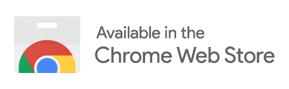
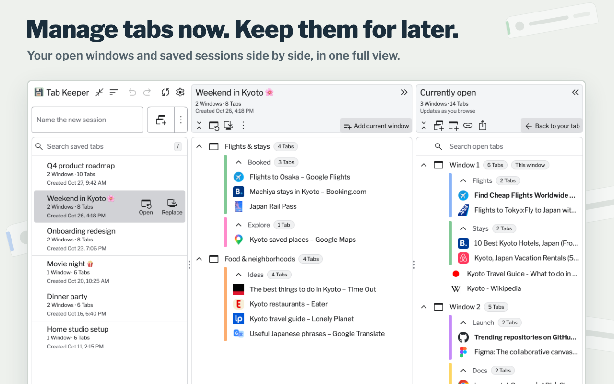

# Tab Keeper - Session & Tab Manager

<a href="https://chromewebstore.google.com/detail/tab-keeper-chrome-tab-man/gpibgniomobngodpnikhheifblbpbbah?ref=github" target="_blank"></a>

Tab Keeper is a free, open-source session and tab manager for Chrome. It manages the tabs you have open now and keeps the ones you want for later: see every window and tab group in one full view, save them as a session in one click, and bring them back with their tab group names and colors. Sync across desktop Chrome without creating an account or providing an email address.

[](https://chromewebstore.google.com/detail/tab-keeper-chrome-tab-man/gpibgniomobngodpnikhheifblbpbbah?ref=github)
[](#changelog)

[](https://raw.githubusercontent.com/justine-george/tab-keeper-react-chrome-extension/main/LICENSE)

<a href="https://chromewebstore.google.com/detail/tab-keeper-chrome-tab-man/gpibgniomobngodpnikhheifblbpbbah?ref=github" target="_blank"></a>

## Features

- **Currently Open:** See every window, tab group and tab you have open right now beside your saved sessions. Bring a window to the front, go to a tab group, or rename and recolor it.
- **Full View:** Open Tab Keeper in its own tab with panes you can widen, and go back to your tab in one click.
- **Save & Restore:** Save every open window as a session, or just the current one, and reopen it later. Sessions keep tab groups with their names and colors, pinned tabs, collapsed groups, and maximized and full-screen windows.
- **Drag Between Open and Saved:** Drop open tabs into a session to keep them, or drag saved tabs into Currently open to open them. Reorder tabs, groups, windows and sessions the same way.
- **Switch & Replace:** Jump to a saved session while Tab Keeper saves your current windows first, or replace a session with the windows you have open now.
- **Undo & Tidy Up:** Undo a delete, remove duplicate tabs, and sort tabs by site.
- **Save as PDF:** Preview any session, or the windows you have open, as a clean document, rename titles or hide rows, then save it as a PDF or print it. Or copy all its links at once.
- **Device Sync:** Turn on sync to access your sessions from Chrome desktop browsers connected to the same Chrome profile.
- **Privacy First:** No email address, account setup, or signup required. Sessions stay on your device until you choose to sync.
- **Backup to File:** Save your sessions and settings to a file, and load them back by merging or replacing.
- **Import from Bookmarks:** Turn Chrome bookmark folders into saved sessions. Your bookmarks stay as they are.
- **Quick Search:** Find any saved or open tab as you type, by its title or its tab group's name.
- **Keyboard Friendly:** Open Tab Keeper with a shortcut, and use it fully from the keyboard or with a screen reader.
- **Multi-Language Support:** Use Tab Keeper in 13 languages. It starts in Chrome's language.
- **Custom Themes:** Choose from seven light and dark themes, two of them with higher contrast.

## How It Works

1. Open Tab Keeper to see the windows and tabs you have open now, and save one window or all of them as a session.
2. Search, drag and organize your open tabs and saved sessions.
3. Restore a session later, or switch sessions while saving your current windows first.

## Video & Screenshots

https://github.com/user-attachments/assets/62f5a6cc-f2c2-4b4b-b722-ae473c3700fc

[Watch on YouTube →](https://www.youtube.com/watch?v=4_38WtIZxtM)

<a href="https://chromewebstore.google.com/detail/tab-keeper-chrome-tab-man/gpibgniomobngodpnikhheifblbpbbah?ref=github" target="_blank"></a>

[View All Screenshots →](https://github.com/justine-george/tab-keeper-react-chrome-extension/wiki/Screenshots)

## Privacy & Sync

Tab Keeper does not require an email address or a user-created account. It generates an anonymous identifier that Chrome syncs with your browser profile.

Your sessions are stored locally on your device. Tab Keeper asks before it syncs for the first time on each device. When device sync is enabled, saved session data—including tab URLs and titles—is sent to cloud storage so you can access it from other desktop Chrome browsers connected to the same profile. You can delete the cloud copy at any time from Settings → Sync & backup.

Read the full [privacy policy](PRIVACY.md).

## Changelog

### v.2.6.0 (Latest)

#### Features

- Rows, menus and dialogs move into place. Added, saved and synced sessions slide in, deleted rows close up, folds, sorts, drops and edits glide, menus grow from what opened them, and dialogs rise with their dim. Every undo and redo plays its change backwards
- Toasts show how long they have left and can be closed with their ×. Undo closes only the toast of the change it undid
- A saved tab, group or window dropped into Currently open says where it opened, with Undo
- In the full view, a folded pane keeps a card. Click Currently open's folded rail, or carry a drag onto either folded card, to see it beside the saved session

#### Improvements

- The header Undo reopens what you just closed in Currently open, as ⌘Z does
- The tour's search step clears its matches, every lit area is ringed, presses the tour can't take say why, and the drag step lets you try dragging both ways, with an arrow for the way not yet tried
- Setup's steps glide, the tour's dim fades in and out, and the full-view callout grows from ⤢. The tour's ending card links to the story behind Tab Keeper
- A theme or language pick pops its check in, and a theme pick fades the page to the new colors
- The full-view fold buttons say "Give … the full width", and the top row sits on one line
- A drop onto New window lands on the box drawn for it, and the + shows only where letting go makes something
- Settings › Language in the full view uses setup's wider language cells

#### Fixes

- A device on its own no longer shows "Synced changes from another device" after a mix of saves, undos and redos
- A reopened group shows up named and colored straight away
- Dragging a pane's grip no longer lights what it crosses
- A window taken out at the scrolled end of a list leaves with the rows, never under them
- Pane folds keep their edges, corners and frame lines whole mid-move

### v.2.5.0

#### Features

- Import Chrome bookmark folders as saved sessions, from Settings › Import or during setup. Each folder becomes a session, and the folders inside it become its windows. Your bookmarks stay as they are
- Tab groups fold and unfold from the arrow next to their name. In Currently open, Chrome folds the group too. A saved group you fold stays folded when you open it
- Backups carry your settings. Replace, or a load into an empty Tab Keeper, brings them back; Merge keeps this device's

#### Improvements

- The backup buttons read Save a backup and Load a backup
- The sort menu names its dates the way the session line does: Date edited, Date created
- The two skip settings say when they apply: Skip duplicates when saving, Skip duplicates when opening
- Drops onto New window, into the session list and across windows glide into place like a drop within a window
- Text links answer hover with a thicker underline instead of a fill
- Tour cards put Skip tutorial and Not now at the left of the button row
- Accounts near the sync limit sync compressed past 80% of it, so they hold more sessions

#### Fixes

- After a group's only tab is dropped elsewhere, the rows below it no longer jump up
- The group menu's color row sits centered between its two lines

### v.2.4.0

#### Features

- A Chrome split view moves as one, in Currently open and in saved sessions. Right-click either half for End split view
- Drag an open tab, split view or group onto New window in Currently open to move it into a window of its own. Pin Tab Keeper in new windows applies
- A saved tab, group or window dropped into Currently open can be undone, and redone

#### Improvements

- Open full view stays in the window you're in, instead of switching to a full view in another window. On Windows, that kept it from jumping to another virtual desktop
- Saving a new session slides the header mark's shutter
- Tooltips show sooner: 200 ms after the pointer arrives
- A new install starts on the clock its language normally uses: 24-hour in German, Spanish, French, Italian, Japanese, Portuguese, Russian, Swedish and Simplified Chinese; 12-hour in the rest. Settings › Display still switches it
- Swedish drop messages and End split view in four languages read more naturally

#### Fixes

- Another open Tab Keeper page no longer misses a change made in this one
- The strip left of a loose tab keeps its row hovered, edge to edge
- A list with little room left still offers New window at its end while you drag
- A list that fits no longer grows a scrollbar mid-drag
- A carried tab let go beside the pane, level with its own spot, no longer makes a new window
- A carried item lands in a session that already holds its ids

[View All Changelog →](https://github.com/justine-george/tab-keeper-react-chrome-extension/wiki/Changelog)

## Blog Posts

[View All Posts →](https://github.com/justine-george/tab-keeper-react-chrome-extension/wiki/Blog-Posts)

## Development and Contributing

Contributions are welcome! Feel free to open issues or submit pull requests following the established coding style and guidelines.

Install the dependencies and create a production build:

```sh
npm install
npm run build
```

To try the extension locally, open `chrome://extensions`, enable **Developer mode**, choose **Load unpacked**, and select the generated `dist` directory.

Run `npm test` for the unit and component suites, and `npm run test:e2e` for the browser tests against a real build ([details](e2e/README.md)).

## Built With

[React](https://react.dev/), [TypeScript](https://www.typescriptlang.org/), [Redux Toolkit](https://redux-toolkit.js.org/), [Vite](https://vitejs.dev/), [Firebase](https://firebase.google.com/), [Vitest](https://vitest.dev/), [Playwright](https://playwright.dev/), [Emotion](https://emotion.sh/), and [react-i18next](https://react.i18next.com/).

## License

Tab Keeper is released under the [MIT License](https://raw.githubusercontent.com/justine-george/tab-keeper-react-chrome-extension/main/LICENSE).

## Support

Report bugs or request features via [GitHub Issues](https://github.com/justine-george/tab-keeper-react-chrome-extension/issues).
